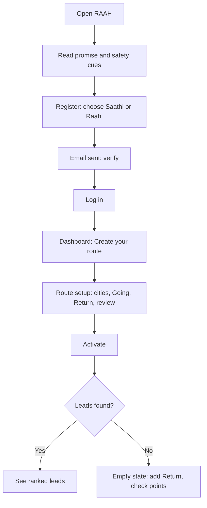
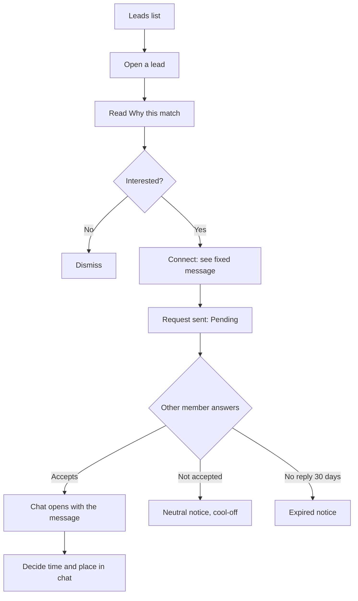
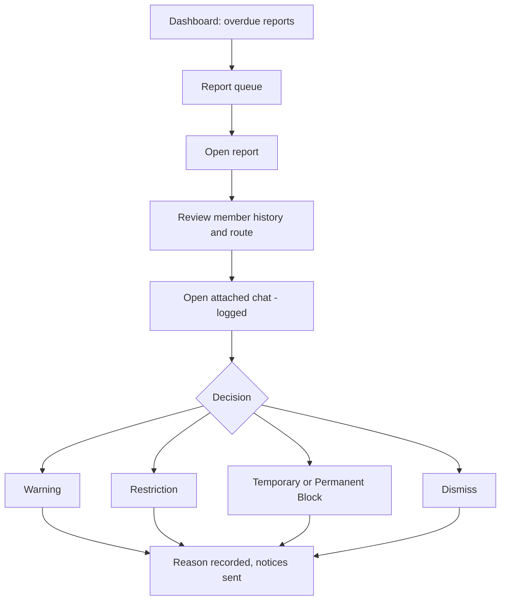

# RAAH — Phase 1 UI Plan and Design

| | |
|---|---|
| **Document type** | UI plan: design principles, design system, navigation, user flows, module-wise screen designs (wireframes), states, responsive and accessibility rules, and the UI delivery plan |
| **Version** | 1.0 — Draft for design review |
| **Based on** | *RAAH Functional Specification v1.0* (screens SCR-x, rules BR-x, statuses) and *RAAH Technical Plan v1.0* (page map, components, API, sprint plan) |
| **Audience** | UX/UI designer, frontend developers, QA, product owner, client |
| **Platform** | One responsive web application: **phone first**, then tablet and desktop (D-20). Admin screens are desktop first |

## How to Read This Plan

| Prefix | Meaning |
|---|---|
| **UP-n** | UI principle (Section 1) |
| **C-n** | Reusable component in the design system (Section 3.6) |
| **F-n** | User flow (Section 5) |
| **W-n.m** | Wireframe of a screen (Section 6) |
| **UD-n** | Open UI decision to confirm (Section 9) |
| **SCR-x, BR-x, CFG-x, D-x, A-x, V-x, AC-x** | IDs of the functional specification |
| **spec Section N** / **plan Section N** | A section of the functional spec / of the technical plan |
| **TP, TD, T-nnn, EP-n** | Technical plan IDs |

**About the wireframes.** They are **structure and content diagrams**: what is on the screen, in what order, with which states. They are not final visual design. Colours, type and spacing come from the design system in Section 3. A clickable visual prototype of the core screens is the next step (Section 8).

## Contents

1. Goals and UI Principles
2. Users and Contexts of Use
3. Design System
4. Information Architecture and Navigation
5. Key User Flows
6. Module-wise UI Design
7. Cross-Module Patterns
8. UI Delivery Plan
9. Open UI Decisions

---

# 1. Goals and UI Principles

## 1.1 What the UI Must Achieve

RAAH asks strangers to share a route and talk to each other. The UI has three jobs:

1. **Get a member to a working route in minutes** (register, verify, enter two legs).
2. **Make every match understandable and every contact safe.** Members must see *why* someone was matched and feel in control of who can reach them.
3. **Give Admin a calm, fast control room** for monitoring, safety and tuning.

## 1.2 Principles

| # | Principle | What it means on screen | From |
|---|---|---|---|
| **UP-1** | **Phone first, thumb first** | Single column, primary action reachable with one thumb, bottom navigation, no hover-only controls | D-20, spec Section 27 |
| **UP-2** | **Explain every match** | Each lead shows match type per leg, shared stretch, days and time gap in plain words, and a "Why this match" view | spec Principle 14, BR-12.1 |
| **UP-3** | **Trust and safety are always one tap away** | Block and Report in lead detail and chat header; a standing safety tip in chat; clear, calm wording | spec Principle 10, M8 |
| **UP-4** | **Show the minimum about people** | Other members appear only as the public view (name, photo, gender, vehicle, verified badge, rating, current route). Never email or mobile | BR-4.9, spec Section 10.5 |
| **UP-5** | **Nothing happens by surprise** | Connect shows the exact fixed message before sending; destructive actions (deactivate, block, disconnect) say what will happen to leads, requests and chats | BR-14.17, BR-10.9, BR-17.1 |
| **UP-6** | **Neutral, never blaming** | A rejection is "Your request was not accepted", with no reason. A block is never announced to the other person | BR-14.6, BR-17.2 |
| **UP-7** | **Ask for the minimum, validate as they type** | Short forms; errors appear beside the field in plain language; the same rules as the server (shared schemas) | TP-1, spec Principle 1 |
| **UP-8** | **The route is the product** | The route form is a guided two-tab flow with a review step; "Copy reversed" removes retyping | M2, A-16 |
| **UP-9** | **One status language** | The same words and colours for the same statuses everywhere (Section 3.7) | spec Section 9 |
| **UP-10** | **Every screen has all its states designed** | Loading, empty, error, success, disabled and "no permission" are designed, not left to chance (Section 7) | BR-13.12, BR-23.6 |
| **UP-11** | **Accessible by default** | Contrast of at least 4.5:1 for text, visible focus, labels on every field, no colour-only meaning, touch targets of at least 44 px | plan Section 9.5 |
| **UP-12** | **Admin density, member calm** | Member screens are spacious and simple; Admin screens are dense tables with filters, but never hide a reason field or a confirmation | spec Section 19–24 |

---

# 2. Users and Contexts of Use

| User | Typical context | Design consequences |
|---|---|---|
| **Member as Saathi** | On a phone, in a metro or at a bus stop, one-handed, short sessions, patchy network | Large tap targets, fast first load, skeleton loading, saved Drafts, no heavy images |
| **Member as Raahi** | On a phone, before or after a ride; may be wearing gloves or in a hurry | Same as Saathi; accept or reject a request in two taps; vehicle shown clearly |
| **New member** | First visit, unsure what RAAH does or whether it is safe | Clear promise on the first screen ("Find the person before the journey. Decide the journey together."), visible safety and privacy cues, a short guided setup |
| **Admin** | Desktop, long sessions, many records, reviewing safety reports | Dense tables, filters, keyboard-friendly, a clear audit feel (reason fields, confirmations), nothing that looks like it edits a member's own data |

**Network and device assumptions (India).** Mid-range Android phones and Chrome are the main target, with Safari on iPhone. The UI must stay usable on slow connections: server-rendered first paint, small images (photos shown as small thumbnails), skeletons instead of spinners, and no required animation.

---

# 3. Design System

## 3.1 Brand and Tone

| Item | Direction |
|---|---|
| Name and tagline | **RAAH** — *Jaha Chaah Waha Raah* |
| Mood | Trustworthy, warm, urban and everyday. Not flashy. A commute tool that feels safe |
| Voice | Calm, direct, respectful. Plain English. Short sentences. Never alarming, never blaming (UP-6) |
| Logo | To be supplied by the client (UD-1). The plan reserves a 32 px mark with the word "RAAH" in the header |

## 3.2 Colour

All values are checked against WCAG contrast (ratio of text colour to its background).

| Role | Name | Hex | Used for | Contrast |
|---|---|---|---|---|
| **Brand / Saathi** | Indigo 600 | `#4F46E5` | Primary buttons, links, Saathi chip, active tab | White on it: **6.3:1** |
| Brand hover/pressed | Indigo 700 | `#4338CA` | Pressed and hover states | White on it: 7.9:1 |
| Brand tint | Indigo 50 | `#EEF2FF` | Selected rows, soft backgrounds | Indigo 600 on it: 5.6:1 |
| **Raahi** | Teal 700 | `#0F766E` | Raahi chip, Raahi accents | White on it: **5.5:1** |
| Raahi tint | Teal 50 | `#F0FDFA` | Raahi soft background | Teal 700 on it: 5.3:1 |
| **Success / Full Route** | Green 700 | `#15803D` | Active, Accepted, Full Route badge | White on it: 5.0:1 |
| Success tint | Green 50 | `#F0FDF4` | Success banners | Green 700 on it: 4.8:1 |
| **Warning / Pending** | Amber 700 | `#B45309` | Pending, Under Review, Restricted | White on it: 5.0:1 |
| Warning tint | Amber 50 | `#FFFBEB` | Warning banners | Amber 700 on it: 4.8:1 |
| **Danger** | Red 700 | `#B91C1C` | Errors, Blocked, destructive buttons | White on it: 6.5:1 |
| Danger tint | Red 50 | `#FEF2F2` | Error banners | Red 700 on it: 5.9:1 |
| **Info / Useful Segment** | Sky 700 | `#0369A1` | Useful Segment badge, info banners | White on it: 5.9:1 |
| Info tint | Sky 50 | `#F0F9FF` | Info banners | Sky 700 on it: 5.6:1 |
| Text primary | Slate 900 | `#0F172A` | Body and headings | On white: 17.9:1 |
| Text secondary | Slate 600 | `#475569` | Helper text, captions | On white: 7.6:1 |
| Text tertiary | Slate 500 | `#64748B` | Placeholders, timestamps | On white: 4.8:1 |
| **Input / control border** | Slate 500 | `#64748B` | Borders of inputs, checkboxes, toggles | On white: 4.8:1 (needs 3:1) |
| Divider | Slate 300 | `#CBD5E1` | Decorative dividers only | 1.5:1, never used for a control edge |
| Background | Slate 50 | `#F8FAFC` | Page background | — |
| Surface | White | `#FFFFFF` | Cards, sheets, inputs | — |
| Disabled text | Slate 400 | `#94A3B8` | Disabled controls only | 2.6:1, allowed only for disabled state |

**Rules.** Never use Slate 400 or Slate 300 for text or for the edge of an input. Never use colour alone to carry meaning: every status badge has a word, and a Full Route or Useful Segment badge has text plus an icon. Dark mode is **not** part of Phase 1 (UD-4); tokens are named by role so it can be added later.

## 3.3 Typography

| Item | Decision |
|---|---|
| Typeface | **Inter** (open, readable, wide language support) with the system UI font as fallback (UD-2). English only in Phase 1 |
| Base size | **16 px** on phone (also stops iPhone zooming into inputs) |
| Scale | Display 28/34 · Heading 1 24/30 · Heading 2 20/26 · Heading 3 17/24 · Body 16/24 · Small 14/20 · Caption 12/16 |
| Weights | Regular 400, Medium 500, Semibold 600. Headings 600 |
| Numbers | Tabular figures in tables, times and counts |
| Dates and times | `09-Oct-2026`, `8:05 AM` (12-hour), India time (TD-17) |

## 3.4 Layout, Spacing and Breakpoints

| Item | Decision |
|---|---|
| Spacing scale (4 px base) | 4 · 8 · 12 · 16 · 24 · 32 · 48 |
| Phone page margin | 16 px; card padding 16 px; space between cards 12 px |
| Shape | Inputs and buttons radius 8 px; cards radius 12 px; chips fully rounded |
| Elevation | Three levels: flat (cards on page), raised (sheets, menus), overlay (dialogs). Prefer borders and tint over heavy shadows |
| Touch targets | At least 44 × 44 px, 8 px between neighbours |
| Breakpoints | **Phone** 360–479 (design at 360) · **Large phone** 480–767 · **Tablet** 768–1023 · **Desktop** 1024–1279 · **Wide** 1280 and up |
| Content width | Member desktop content max 1120 px; Admin content fluid with a 1440 px cap for text-heavy pages |
| Grid | Phone: 4 columns · Tablet: 8 · Desktop: 12, 24 px gutters |
| Safe areas | Bottom navigation and sticky actions respect the device safe area and the on-screen keyboard |

## 3.5 Shape, Motion, Icons

- **Motion:** 150–200 ms ease for sheets, tabs and toasts; no decorative animation; honour "reduce motion".
- **Icons:** one simple line-icon set (UD-3), 20 px inline and 24 px in navigation, always paired with a text label in navigation and buttons.
- **Photos:** circular avatars (40 px in lists, 72 px in profile, 96 px in lead detail); initials on a tinted background when there is no photo.

## 3.6 Component Inventory

Every component is built once in the component library (task T-012 and the UI tasks of Section 8) and reused.

| # | Component | Purpose and key behaviour | States |
|---|---|---|---|
| **C-1** | **Button** | Primary, secondary, tertiary, destructive; sizes large (48), default (44), small (36, Admin only). One primary per screen area | Default, hover, pressed, focus, disabled, loading |
| **C-2** | **Text field** | Label above, helper text below, inline error text; counters where there is a limit | Default, focus, filled, error, disabled |
| **C-3** | **Password field** | Show/hide toggle; strength hint using the rule "8+ characters with a letter and a number" | As C-2 |
| **C-4** | **Select** | Native select on phone for speed; custom list on desktop where search helps (cities) | Default, open, error |
| **C-5** | **Role card (radio)** | Two large cards "I am a Saathi" / "I am a Raahi" with one-line explanation each | Unselected, selected, focus |
| **C-6** | **Checkbox / switch** | Checkbox for agreements, switch for on/off settings | Off, on, disabled |
| **C-7** | **Day selector** | Seven round toggles Mon–Sun with "Weekdays" and "All" shortcuts | Per day on/off, error (none chosen) |
| **C-8** | **Time field** | 12-hour time with AM/PM, phone time picker | Default, error |
| **C-9** | **Route point input** | Text field with a "pin" number, drag handle or up/down buttons, remove button, and the hint "Enter an area or landmark" | Default, error (invalid text, same place), focus |
| **C-10** | **Tabs** | Going / Return on the route form; underlined, with a check or alert dot per tab | Active, inactive, has-error |
| **C-11** | **Segmented control** | Leads / Requests; Received / Sent; filter groups | Selected, focus |
| **C-12** | **Badge / chip** | Role (Saathi, Raahi), vehicle (Bike, Car), match type (Full Route, Useful Segment), statuses (Section 3.7), verified | Colour by meaning, always with text |
| **C-13** | **Avatar** | Photo or initials; optional verified tick | Photo, initials |
| **C-14** | **Rating stars** | Read-only (1 decimal and count) and input (tap 1–5); "New member" when under CFG-28 ratings | Read-only, input, hover, focus |
| **C-15** | **Route line** | Vertical line of points with the shared stretch highlighted and unmatched points muted; start and end marked | Going, Return, highlighted, compact |
| **C-16** | **Lead card** | Person, match badges per leg, shared stretch, days, times, gap, Connect and Dismiss | New, viewed, requested, connected, cool-off |
| **C-17** | **Request card** | Person, days left, route changed note, Accept / Reject or Withdraw | Pending, expiring, answered |
| **C-18** | **Conversation row** | Avatar, name, last message, time, unread count, closed marker | Unread, read, closed |
| **C-19** | **Message bubble and composer** | Text bubbles with time; composer fixed at bottom; disabled with a note when the chat is closed | Sent, received, system (first message), closed |
| **C-20** | **Notification item** | Icon, one line, time, unread dot, link | Unread, read |
| **C-21** | **Banner** | Info, success, warning, error, **safety tip**, **setup prompt**, **sample legal text alert** | Dismissible or fixed |
| **C-22** | **Toast** | Short confirmation, 4 seconds, announced to screen readers | Success, error |
| **C-23** | **Dialog (confirm)** | Title, what will happen, secondary and primary buttons; destructive uses red; reason field in Admin | Default, loading |
| **C-24** | **Bottom sheet** | Phone modal for Connect confirmation, filters, actions; becomes a centred dialog on desktop | Open, closing |
| **C-25** | **Empty state** | Icon, one sentence, one next action | Per screen |
| **C-26** | **Skeleton** | Placeholder shapes for cards and rows while loading | — |
| **C-27** | **Filter bar** | Leg and Gender controls on leads; Admin filter rows; "Clear all" | Active filter count |
| **C-28** | **Data table** | Admin tables with sort, filters, column chooser, saved filters, export; collapses to cards on small screens | Loading, empty, error, selected |
| **C-29** | **Stat tile** | Number, label, optional trend, click to drill down | Normal, alert |
| **C-30** | **Stepper** | Route setup progress: Cities → Going → Return → Review | Done, current, todo |
| **C-31** | **Photo upload** | Pick, crop to circle, preview, size and type guidance | Empty, uploading, done, error |
| **C-32** | **Rich text editor** | Admin Legal Content: headings, lists, links; preview | Edit, preview |
| **C-33** | **Key-value list** | Detail pages: label and value rows | — |
| **C-34** | **History timeline** | History tab: date, user, action, detail, remarks | — |
| **C-35** | **Show more / pager** | Keyset "Show more" on member lists; numbered pager on Admin tables | — |

## 3.7 Status Badge Map

One badge per status, always text plus colour, using the exact words of spec Section 9.

| Group | Status → colour |
|---|---|
| **Member** | Active (green) · Unverified (amber) · Inactive (slate) · Restricted (amber) · Temporarily Blocked (red outline) · Permanently Blocked (red solid) |
| **Route** | Draft (slate outline) · Active (green) · Inactive (slate) · Invalid (red) · Under Review (amber) |
| **Lead** | New (indigo dot) · Viewed (slate) · Dismissed (slate muted) · Requested (sky) · Withdrawn by System (slate muted, Admin only) |
| **Match type** | Full Route (green with a "route" icon) · Useful Segment (sky with a "part" icon) · No match (slate) |
| **Connection** | Pending (amber) · Accepted (green) · Rejected (slate; the member who was rejected sees "Not accepted") · Withdrawn (slate) · Expired (slate) · Disconnected (slate) · Blocked (red, Admin only; a blocked member sees "Ended") |
| **Report** | Submitted (sky) · Under Review (amber) · Action Taken (indigo) · Dismissed (slate) · Closed (slate) |
| **Rating** | Stars in amber with the number beside them; hidden comment shows "Comment hidden" in slate |
| **Role and vehicle** | Saathi (indigo) · Raahi (teal) · Bike · Car (slate outline with icon) |

## 3.8 Microcopy Guide

| Situation | Copy | Rule |
|---|---|---|
| Promise (first screen) | "Find the person before the journey. Decide the journey together." | Product statement (spec Section 1.4) |
| Request rejected (to sender) | "Your request was not accepted." | No reason, no blame (UP-6) |
| Request expired | "No reply in 30 days. You can send a new request." | Use CFG-5 value |
| Cool-off | "You can request again in 5 days." | Show days left |
| Block (to blocker) | "Blocked. You will no longer see each other. They are not told." | Confirms silence |
| No leads | "No relevant person found yet. We will tell you when someone matches. You can add a Return leg or check your points and times." | spec SC-13.8 |
| Route point hint | "Enter an area or landmark, for example Badarpur Metro. You do not need your full address." | Privacy of home area |
| Same place error | "These two points look like the same place. Change one of them." | Names both points |
| Phone number typed | "Please do not enter phone numbers or links. You can chat after the request is accepted." | spec SC-11.7 |
| Connect confirmation | "This message will be sent: Hello, I want to connect with you." | Fixed text (D-23) |
| Accepted | "You can now chat. Decide time, meeting point and shared portion together." | BR-14.15 |
| Chat safety tip | "Do not share personal details or money until you trust the person. You can block or report at any time." | BR-15.9 |
| Session expired | "You were logged out for security. Log in to continue. Your route entry is saved on this screen." | BR-5.6 |
| Generic login failure | "Invalid credentials or inactive account." | Never says which (BR-5.4) |
| Admin reason field | "Reason (at least 10 characters). This is recorded in the audit trail." | V-45 |
| Sample legal alert (Admin) | "Legal text is still the sample. Replace and publish final text before real members join." | BR-22.13 |

**Style rules.** Sentence case. Active voice. One idea per sentence. Numbers as digits. No exclamation marks in safety or error messages. Never ask a member to "try again later" without saying what happened.

## 3.9 Accessibility Rules

| Area | Rule |
|---|---|
| Contrast | Text 4.5:1 or more; large text and control edges 3:1 or more (palette checked in Section 3.2) |
| Focus | Visible 2 px focus ring in Indigo 600 with a white gap, never removed |
| Labels | Every field has a visible label; placeholders never replace labels |
| Targets | 44 px minimum |
| Colour | Never the only carrier of meaning (badges have words; errors have an icon and text) |
| Keyboard | Registration, route form, leads, requests, chat and Admin tables work by keyboard; dialogs trap focus and return it |
| Screen readers | Toasts and new chat messages use polite live regions; the route point list announces position ("Point 2 of 5") and reorder actions |
| Motion | Respect "reduce motion" |
| Zoom | Layout works at 200% text size without horizontal scroll (except Admin tables, which scroll inside their container) |
| Language | `lang="en"`; dates in a readable form, not only numeric |

---

# 4. Information Architecture and Navigation

## 4.1 Member Navigation

**Phone: bottom tab bar with five tabs.** The top bar shows the RAAH mark, the journey role chip (Saathi or Raahi), and the notification bell with an unread count.

| Tab | Contains | Spec screens |
|---|---|---|
| **Home** | Dashboard with setup prompts, My Route, new leads, requests, connections, notifications, safety links | SCR-23.1 |
| **Route** | My Route summary, edit, review, history | SCR-11.1 to 11.4 |
| **Leads** | Segmented: **Leads · Requests · Dismissed**. Lead detail opens over it | SCR-13.1 to 13.3, SCR-14.1 to 14.3 |
| **Chats** | Conversations (Accepted connections, closed ones under a filter); connection detail from the chat header | SCR-14.4, SCR-14.5, SCR-15.1, SCR-15.2 |
| **Me** | Profile, how others see me, change role, ratings, blocked members, my reports, notification settings, legal texts, account and password, log out | SCR-10.1 to 10.5, 16.2, 16.3, 17.2, 17.4, 18.2, 5.6, 5.7 |

Badges on tabs: Leads shows the count of new leads plus pending received requests; Chats shows unread conversations.

**Desktop and tablet.** A left sidebar with the same five groups replaces the bottom bar. Leads and Chats use **master-detail**: the list on the left, the selected lead or conversation on the right (two columns from 1024 px).

## 4.2 Admin Navigation

A left sidebar (collapsible) with a top bar holding global search (member number, name, email, route number), the notification bell and the Admin menu.

| Group | Items | Spec screens |
|---|---|---|
| **Dashboard** | Admin Dashboard | SCR-23.2 |
| **Members** | Member list and detail | SCR-19.1 to 19.4 |
| **Routes and matching** | Route monitor · Leads · Connections · Matching Health | SCR-20.1 to 20.5 |
| **Safety** | Report queue · Restricted and Blocked · Flagged members · Rating moderation | SCR-21.1 to 21.6 |
| **Settings** | Configuration · Test Match · Legal Content · Cities · City requests | SCR-22.1 to 22.6 |
| **Reports** | Reports catalogue (30 reports) | spec Section 24 |

## 4.3 Global Elements and Gates

| Element | Behaviour | Spec |
|---|---|---|
| **Verify-email gate** | An Unverified member sees only a "Verify your email" screen with Resend; no route or lead screens | BR-5.1 |
| **Legal re-acceptance gate** | If a new required version is pending, every page shows the accept screen first; only the legal texts and Log out are reachable | BR-22.16 |
| **Session-expiry dialog** | On idle timeout, a dialog explains and returns to login; the route form keeps its input in memory | BR-5.6 |
| **Restricted banner** | A Restricted member sees an amber banner on Leads and Requests: "You cannot send new requests until *date*." Other functions work | BR-21.6 |
| **Blocked or Inactive account** | Cannot log in; login shows the generic message | BR-5.4 |
| **Offline notice** | A slim banner "No connection. Changes will not be saved." Writes are never queued offline in Phase 1 | spec Section 27 |
| **Safety shortcuts** | Block and Report in lead detail, connection detail and chat header menu | UP-3 |

---

# 5. Key User Flows

## F-1 First-time member: from sign-up to first leads



## F-2 Create and activate a route

Cities → Going leg (points, days, time) → Return leg (optional: **Copy reversed**, enter time) → Review (both legs side by side) → Activate. At any step the member can **Save Draft**. Validation errors appear on the tab where they occur, with a dot on the tab.

## F-3 Find, connect and chat



## F-4 Answer a request

Notification or Leads → Requests → open the request → read the sender's public profile and route comparison → **Accept** or **Reject** (two taps, with a confirmation only for Reject). Accept opens the chat.

## F-5 Chat and rate

Chats → open conversation → send and receive → later: Rate (stars and optional comment) from the connection detail.

## F-6 Block or report

From a lead, connection or chat: menu → **Block** (confirm sheet states the effects) or **Report** (reason, description, "also block" switch, notice that Admin can read the attached chat, emergency note). My Reports shows status afterwards.

## F-7 Change journey role

Me → Change journey role → the screen explains what deactivation does (leads and pending requests withdrawn, connections and chats stay) → deactivate current route → choose vehicle if switching to Raahi → create the new route.

## F-8 Admin handles a safety report



## F-9 Admin tunes matching

Matching Health (no-lead routes, unmatched stops) → Test Match with sample points → change CFG-22 or CFG-1 in Configuration (range shown, reason optional) → optionally **Recalculate all leads** (confirmation shows that leads may be withdrawn) → read the run summary.
---

# 6. Module-wise UI Design

## 6.0 How to Read the Module Designs

Each module follows the same pattern: **Screens**, **Wireframes**, **Components used**, **States**, **Interaction and validation**, **Responsive notes**, **Rules the screen must show**. Wireframes are drawn at **phone width (360)** unless marked *desktop*.

| Symbol | Meaning |
|---|---|
| `[ Button ]` | Button (primary if it is the only filled one in the block) |
| `[______]` | Text field |
| `[ Select ▼ ]` | Select |
| `( ) (•)` | Radio, unselected / selected |
| `[ ] [x]` | Checkbox, unchecked / checked |
| `≡` | Drag handle for reordering |
| `✕` | Remove |
| `●` | A point on a route line; `◉` a shared (highlighted) point |
| `⋯` | Overflow menu |
| `(i)` | Information hint |
| `★` | Rating star |

---

## 6.1 Account and Access (spec Section 5)

### Screens

| Screen | Path | Who |
|---|---|---|
| SCR-5.1 Register | `/register` | Public |
| SCR-5.2 Verify email | `/verify-email` | Public |
| SCR-5.3 Login (also Admin login, SCR-5.8) | `/login` | Public |
| SCR-5.4 Forgot password, SCR-5.5 Reset password | `/forgot-password`, `/reset-password` | Public |
| SCR-5.6 Change password, SCR-5.7 My Account | `/account` | Member, Admin |
| Legal re-acceptance gate | `/accept-terms` | Member |
| Public legal pages | `/legal/terms`, `/legal/privacy`, `/legal/safety` | Public |

### W-1.1 Register

```text
┌────────────────────────────────────────┐
│  RAAH                                  │
│  Find the person before the journey.   │
│  Decide the journey together.          │
├────────────────────────────────────────┤
│  I am a                                │
│  ┌──────────────────┐ ┌──────────────┐ │
│  │ ( ) Saathi       │ │ (•) Raahi    │ │
│  │ I am looking for │ │ I travel this│ │
│  │ someone to travel│ │ route often  │ │
│  │ with             │ │ and can take │ │
│  │                  │ │ a co-traveller│ │
│  └──────────────────┘ └──────────────┘ │
│  Vehicle                               │
│  (•) Bike   ( ) Car                    │  ← only when Raahi is chosen
│                                        │
│  Full name                             │
│  [______________________________]      │
│  Email                                 │
│  [______________________________]      │
│  Password                              │
│  [______________________] [Show]       │
│  8 or more characters, a letter and    │
│  a number                              │
│  Confirm password                      │
│  [______________________________]      │
│  Gender                                │
│  [ Select ▼ ]                          │
│  Mobile number (optional)              │
│  [______________________________]      │
│  (i) Never shown to other members      │
│                                        │
│  [x] I accept the Terms of Use,        │
│      Privacy Policy and Safety         │
│      Guidelines                        │
│                                        │
│  [         Create account         ]    │
│  Already a member? Log in              │
└────────────────────────────────────────┘
```

| Aspect | Design |
|---|---|
| Order | Role cards first (D-18), Vehicle appears only for Raahi (BR-5.12), then the remaining fields in the order of spec Section 5.2 |
| Components | C-5, C-2, C-3, C-4, C-6, C-1 |
| Validation | On blur and on submit, inline, in plain words: "Enter a valid email", "Choose Bike or Car", "Passwords do not match". The button stays enabled and focus moves to the first error |
| Duplicate email | "This email is already registered. Try logging in or reset your password." (BR-5.3) |
| Legal links | Three links open the public texts in a sheet, so the member does not lose the form (BR-5.13) |
| After submit | Go to Verify email (W-1.2) |
| Responsive | Desktop: centred 480 px card with the promise text on the left half |
| States | Loading on submit; server error banner above the button |

### W-1.2 Verify email

```text
┌────────────────────────────────────────┐
│  Check your email                      │
│  We sent a link to a•••@mail.com.      │
│  Open it to finish setting up.         │
│  The link works for 24 hours.          │
│                                        │
│  [      Resend link  (wait 0:45)    ]  │
│                                        │
│  Wrong address? Create the account     │
│  again with the right email.           │
└────────────────────────────────────────┘
```

States: **link opened in time** → "Email verified" and a Log in button; **link expired** → "This link has expired" and a Send a new link button; **Resend cooldown** shown as a countdown from CFG-23 (BR-5.2). An Unverified member who logs in lands here and nowhere else (BR-5.1).

### W-1.3 Login

```text
┌────────────────────────────────────────┐
│  Log in                                │
│  Email                                 │
│  [______________________________]      │
│  Password                              │
│  [______________________] [Show]       │
│  [x] Remember this device              │
│  [            Log in              ]    │
│  Forgot password?                      │
│  New here? Create an account           │
└────────────────────────────────────────┘
```

| State | Message |
|---|---|
| Wrong credentials, Inactive or Blocked | "Invalid credentials or inactive account." (never says which, BR-5.4) |
| Locked | "Your account is temporarily locked. Try again in 15 minutes." (BR-5.5) |
| Idle timeout return | "You were logged out for security. Log in to continue." |
| Admin | The same screen; after login the role decides whether the Member or the Admin UI opens (BR-5.11) |

### W-1.4 Forgot and reset password

Forgot: one field and a button. After sending, **always** "If this email is registered, a reset link has been sent" (SC-5.6). Reset: new password and confirm, with the same rule hint; success returns to login and explains that other devices were logged out.

### W-1.5 Legal re-acceptance gate

```text
┌────────────────────────────────────────┐
│  We updated our Terms of Use           │
│  Effective 12-Nov-2026                 │
│  [ Terms of Use ][ Privacy ][ Safety ] │
│  ┌──────────────────────────────────┐  │
│  │ (document text, scrolls)         │  │
│  └──────────────────────────────────┘  │
│  [x] I accept the updated documents    │
│  [   Accept and continue   ]           │
│  Log out                               │
└────────────────────────────────────────┘
```

Shown only when a required version is pending (BR-22.16). Until accepted, only the texts and Log out work. The three documents sit in tabs; the button is enabled once the box is ticked.

### Change password and My Account

Change password: current, new, confirm. My Account (SCR-5.7): name, email, verification status, journey role, member since, and links to Change password and Log out.

---

## 6.2 M1 — Member Profile (spec Section 10)

### Screens

| Screen | Path |
|---|---|
| Me tab (hub) | `/me` |
| SCR-10.1 My Profile, SCR-10.2 Edit Profile | `/profile`, `/profile/edit` |
| SCR-10.3 How others see me | `/profile/preview` |
| SCR-10.4 Change journey role | `/profile/role` |
| SCR-10.5 Deactivate my account | `/profile/deactivate` |

### W-2.1 Me tab

```text
┌────────────────────────────────────────┐
│  (Avatar 72)  Ashish Kumar             │
│  [Saathi]  Email verified ✓            │
│  ★ 4.6 (12 ratings)   Member since Oct │
│  [ Edit profile ]                      │
├────────────────────────────────────────┤
│  How others see me                  >  │
│  Change journey role                >  │
│  Ratings I received and gave        >  │
│  Blocked members                    >  │
│  My reports                         >  │
│  Notification settings              >  │
│  Terms, Privacy, Safety Guidelines  >  │
│  Account and password               >  │
│  Deactivate my account              >  │
│  Log out                               │
└────────────────────────────────────────┘
```

Under 3 ratings the line reads "New member" instead of a number (BR-16.6).

### W-2.2 Edit profile

```text
┌────────────────────────────────────────┐
│  ← Edit profile                        │
│        (Photo 96)   [ Change photo ]   │
│        JPG or PNG, up to 5 MB          │
│  Full name                             │
│  [Ashish Kumar__________________]      │
│  Email                                 │
│  [ashish@mail.com_______] [ Change ]   │
│  Mobile number (optional)              │
│  [__________________________]          │
│  (i) Not shown to other members        │
│  Vehicle                      (Raahi)  │
│  (•) Bike  ( ) Car                     │
│  Gender                                │
│  Male  [lock]  Only support can correct it │
│  [          Save changes          ]    │
└────────────────────────────────────────┘
```

| Aspect | Design |
|---|---|
| Gender | Read-only with a lock icon and the reason (BR-10.3). The support route for correction is Open Decision UD-7 |
| Email change | "Change" opens a sheet; after sending, the screen says "We sent a link to the new address. Your login email changes when you open it." (BR-10.4) |
| Photo | C-31: pick, crop to a circle, preview; errors "Please upload a JPG or PNG up to 5 MB." |
| Vehicle | Shown only for a Raahi; mandatory (BR-5.12) |
| States | Saving, saved toast, field errors |

### W-2.3 How others see me

```text
┌────────────────────────────────────────┐
│  ← How others see me                   │
│  This is what members see on a lead.   │
│  ┌──────────────────────────────────┐  │
│  │ (Avatar) Ashish K.   ★ New member│  │
│  │ Saathi · Male · Email verified ✓ │  │
│  │ Member since Oct 2026            │  │
│  │ Current route: Delhi → Noida     │  │
│  │  Going  ...   Return  ...        │  │
│  └──────────────────────────────────┘  │
│  Never shown: email, mobile number.    │
└────────────────────────────────────────┘
```

### W-2.4 Change journey role

A single explanatory card: "You are a Saathi. To become a Raahi, your current route must be switched off first. This withdraws your leads and pending requests. Your existing connections and chats stay." Buttons: **Deactivate route and continue** (destructive style), Cancel. Then the Vehicle field if switching to Raahi, then the route setup (BR-10.7).

### W-2.5 Deactivate my account

A list of what happens (route off, pending requests withdrawn, connections closed, chats closed, "Only Admin can reactivate your account") and a confirm dialog with a typed word is **not** used; a checkbox "I understand" and a red button are enough (BR-10.9).

### Responsive and states

Desktop: profile in two columns (photo and facts left, settings right). Empty photo shows initials. Rating shows "New member" until CFG-28 ratings.

---

## 6.3 M2 — Route Management (spec Section 11)

### Screens

| Screen | Path |
|---|---|
| SCR-11.1 My Route | `/route` |
| SCR-11.2 Create / Edit Route (stepper: Cities, Going, Return, Review) | `/route/edit` |
| SCR-11.3 Review and Activate | `/route/review` |
| SCR-11.4 Route history | `/route/history` |

### W-3.1 My Route (Active)

```text
┌────────────────────────────────────────┐
│  My route                [Active]      │
│  Delhi → Noida          Saathi         │
│  ┌──────────────────────────────────┐  │
│  │ Going  Mon–Fri · 8:00 AM         │  │
│  │ Vinay Nagar ● Badarpur Metro ●   │  │
│  │ Govindpuri ● Kalkaji ● Nehru Pl. │  │
│  ├──────────────────────────────────┤  │
│  │ Return Mon–Fri · 6:30 PM         │  │
│  │ Nehru Place ● ... ● Vinay Nagar  │  │
│  └──────────────────────────────────┘  │
│  [ Edit route ]  [ Switch off ]        │
│  Route history                      >  │
└────────────────────────────────────────┘
```

| Route state | What the screen shows |
|---|---|
| **No route** | Empty state: "Create your route to find people who travel your way." and a button |
| **Draft** | Badge Draft, "Continue setting up", progress in the stepper |
| **Active** | As above |
| **Inactive** | Badge Inactive and a **Switch on** button (BR-11.15) |
| **Under Review** | Amber banner "This route is under review. You cannot change it for now." Edit disabled (G-1) |
| **Invalid** | Red banner naming the broken rule and a button to fix it |

Edit while Active shows an info banner: "Editing creates a new version. Your leads will be recalculated. Pending requests and connections are not affected." (BR-11.13).

### W-3.2 Stepper and Cities (step 1)

```text
┌────────────────────────────────────────┐
│  ← Create route             Save draft │
│  ①Cities ─ ②Going ─ ③Return ─ ④Review │
│  Where does your journey start and end?│
│  Start city                            │
│  [ Select ▼ ]                          │
│  End city                              │
│  [ Select ▼ ]                          │
│  (i) A route can start and end in the  │
│  same city.                            │
│  My city is not listed                 │
│  [           Next: Going leg       ]   │
└────────────────────────────────────────┘
```

"My city is not listed" opens a sheet with one field (the city name) and a note that Admin will add it; the member can keep working on a Draft (A-56, BR-11.20).

### W-3.3 Going leg (step 2)

```text
┌────────────────────────────────────────┐
│  ← Create route             Save draft │
│  ①Cities ─ ②Going ─ ③Return ─ ④Review │
│  [ Going ● ]  [ Return ]               │
│  Start point                           │
│  ① [Vinay Nagar_______________] ≡      │
│  Stops on the way (up to 3)            │
│  ② [Badarpur Metro____________] ≡ ✕    │
│  ③ [Govindpuri________________] ≡ ✕    │
│  [ + Add a stop ]                      │
│  End point                             │
│  ④ [Nehru Place_______________] ≡      │
│  (i) Enter an area or landmark, for    │
│  example Badarpur Metro. You do not    │
│  need your full address.               │
│                                        │
│  Travel days                           │
│  (M)(T)(W)(T)(F)( S )( S )  Weekdays   │
│  Leaves around                         │
│  [ 8:00 AM ]                           │
│  [        Next: Return leg         ]   │
└────────────────────────────────────────┘
```

| Aspect | Design |
|---|---|
| Point list | Start and End are fixed in place; stops between can be reordered by drag handle or up/down buttons (keyboard and screen reader friendly); positions are renumbered as the order changes |
| Limits | "Add a stop" disappears at the limit with the note "A leg can have at most 5 points, including Start and End." (CFG-2, V-15) |
| Free text | No suggestions or autocomplete (D-17) |
| Inline errors | Same place: names both points ("Start and End look like the same place" / "Govindpuri and Govindpure look like the same place"); phone number or link: "Please do not enter phone numbers or links."; length |
| Same-place warning | Appears **as the member types** using the shared matching function, so the server never surprises them (BR-11.6) |
| Days | At least one; shortcut "Weekdays" and "All"; error "Choose at least one day" |
| Time | Time field with AM/PM |
| Tab markers | A dot on a tab means it has an error; a check means complete |
| Autosave | Draft is saved on "Save draft" and on leaving the screen with a prompt |

### W-3.4 Return leg (step 3)

The same form as the Going leg with three differences, shown at the top:

```text
│  [ Going ✓ ]  [ Return ● ]             │
│  [ Copy reversed from Going leg ]      │
│  Travel days default to the Going days │
│  Leaves around  [ __:__ ]  ← empty     │
│  Skip Return leg                       │  ← hidden when Return is mandatory
```

**Copy reversed** fills the points in reverse order and the same days; the departure time stays empty and must be entered (A-16). "Skip Return leg" is shown only when CFG-19 is off (A-15). A gentle note appears if the Return time is earlier than the Going time (BR-11.10).

### W-3.5 Review and activate (step 4)

```text
┌────────────────────────────────────────┐
│  ← Review your route                   │
│  Delhi → Noida          Saathi         │
│  Going  Mon–Fri · 8:00 AM              │
│   ① Vinay Nagar                        │
│   ② Badarpur Metro                     │
│   ③ Govindpuri                         │
│   ④ Nehru Place                        │
│  Return Mon–Fri · 6:30 PM              │
│   ① Nehru Place ... ④ Vinay Nagar      │
│  Checklist                             │
│   ✓ Email verified                     │
│   ✓ Cities chosen                      │
│   ✓ Going leg complete                 │
│   ✓ Return leg complete                │
│   ✓ Vehicle (Raahi)                    │
│  [        Activate route          ]    │
│  [ Go back and edit ]                  │
└────────────────────────────────────────┘
```

A failed check shows a red cross with the reason and a link to fix it (from `ROUTE_INCOMPLETE`). After activation: success screen "Your route is active. We are looking for people who travel your way. This usually takes under a minute." with a button to Leads.

### W-3.6 Route history

A list of past routes and versions: number, dates, status badge, a read-only route line, and the History tab timeline (C-34, BR-8.6).

### Responsive

Desktop: the stepper is a left rail; the Going and Return legs sit side by side on the Review screen; point rows are wider with inline reorder buttons.

### Rules the screen must show

One Active route only (BR-11.1); cities required (BR-11.20); points between 2 and 5 per leg; start and end mandatory; deactivation consequences stated in the confirm dialog (BR-11.14).

---

## 6.4 M3 and M4 — Matching Results and Leads (spec Sections 12, 13)

Matching itself has no screen; its result appears as leads. The Leads tab has three segments: **Leads**, **Requests**, **Dismissed**.

### Screens

| Screen | Path |
|---|---|
| SCR-13.1 My Leads | `/leads` |
| SCR-13.2 Lead detail | `/leads/[id]` |
| SCR-13.3 Dismissed leads | `/leads/dismissed` |
| SCR-14.1 Connect confirmation | Bottom sheet on a lead |

### W-4.1 Leads list (phone)

```text
┌────────────────────────────────────────┐
│  Leads      Requests (2)   Dismissed   │
│  Raahis for you            5 found     │
│  Leg: [Any ▼]  Gender: [Any ▼]  Clear  │
├────────────────────────────────────────┤
│  (Av) Neha S.             ★ 4.6 (12)   │
│  Raahi · Car · Email verified ✓        │
│  Going   [Full Route]                  │
│   Vinay Nagar ◉ Govindpuri ◉ Kalkaji ◉ │
│   Nehru Place ◉                        │
│   Tue–Thu · 7:50 AM · 10 min apart     │
│  Return  [Full Route]                  │
│   Nehru Place ◉ ... Vinay Nagar ◉      │
│   Tue–Thu · 6:20 PM · 10 min apart     │
│  [ Connect ]            Not interested │
├────────────────────────────────────────┤
│  (Av) Rohit M.            ★ New member │
│  Raahi · Bike                          │
│  Going   [Useful Segment]              │
│   Kalkaji ◉ ─ Nehru Place ◉            │
│   Mon–Fri · 8:00 AM · same time        │
│  Return  No match                      │
│  [ Connect ]            Not interested │
└────────────────────────────────────────┘
```

| Aspect | Design |
|---|---|
| Heading | Role-aware: a Saathi sees "Raahis for you", a Raahi sees "Saathis for you" |
| Order | Exactly the ranking of spec Section 12.6 (both legs first, Full Route first, more shared points, smaller gap). The UI never re-sorts |
| Match lines | Badge per leg (Full Route green, Useful Segment sky, or "No match"), the shared stretch drawn on a compact route line (C-15), days, both times and the gap |
| Wording | Saathi: "This Raahi covers your whole route" / "…shares part of your route". Raahi: "Your route covers this Saathi's whole route" / "You share part of this Saathi's route" (spec Section 13.4) |
| Filters | **Leg** Any / Going / Return; **Gender** Any / Male / Female (CFG-12, CFG-20). They only change what is shown; count text updates ("2 of 5 shown") |
| Paging | First CFG-7 leads, then **Show more** (keyset) |
| Privacy | No email, no mobile; no other member data than the public view |

**Lead card states (C-16)**

| State | Card shows |
|---|---|
| New | Small indigo "New" dot |
| Requested | Primary button replaced by "Request sent · Pending" |
| Connected | "Connected · Open chat" |
| Cool-off | Disabled button "You can request again in 5 days" (BR-14.6) |
| Restricted member | Connect disabled; amber banner at top "You cannot send new requests until *date*" |
| Pending limit | Disabled button; tip "You have too many pending requests. Wait for answers or withdraw one." |

**Empty and filtered-empty states**

| Situation | Message |
|---|---|
| No leads at all | "No relevant person found yet. We will tell you when someone matches. You can add a Return leg or check your points and times." with buttons Edit route and Add Return leg |
| Filters hide everything | "No leads match these filters." with Clear filters |
| No active route | "Activate your route to see leads." with a button |

### W-4.2 Leads (desktop master-detail)

```text
┌────────────────────┬────────────────────────────────────────────┐
│ Leads Requests Dis.│  Neha S.   ★ 4.6 (12)   Raahi · Car ✓       │
│ Leg[Any▼] Gen[Any▼]│  ┌──────── Why this match ───────────────┐  │
│ ┌────────────────┐ │  │ Going: Full Route. Shared: 4 points   │  │
│ │▶ Neha S.       │ │  │ Common days Tue–Thu. 10 minutes apart │  │
│ │  Full · Full   │ │  └───────────────────────────────────────┘  │
│ ├────────────────┤ │  Your route          Neha's route           │
│ │  Rohit M.      │ │  ① Vinay Nagar ◉     ① Vinay Nagar ◉        │
│ │  Segment · —   │ │  ...                 ...                    │
│ └────────────────┘ │  [ Connect ]  Dismiss   ⋯                    │
└────────────────────┴────────────────────────────────────────────┘
```

### W-4.3 Lead detail (phone)

```text
┌────────────────────────────────────────┐
│  ← Neha S.                         ⋯   │
│  (Avatar 96)  Neha S.                  │
│  Raahi · Car · Email verified ✓        │
│  ★ 4.6 (12)    Member since Aug 2026   │
│  ┌────────── Why this match ─────────┐ │
│  │ Going   Full Route                │ │
│  │ Shared: Vinay Nagar, Govindpuri,  │ │
│  │ Kalkaji, Nehru Place              │ │
│  │ Common days: Tue, Wed, Thu        │ │
│  │ Time: 7:50 AM and 8:00 AM,        │ │
│  │ 10 minutes apart                  │ │
│  │ Return  Full Route ...            │ │
│  └───────────────────────────────────┘ │
│  Compare routes                        │
│   Going   You            Neha          │
│   ① Vinay Nagar ◉        ① Vinay N. ◉  │
│   ② Badarpur Metro       ② Govindp. ◉  │
│   ③ Govindpuri ◉         ③ Kalkaji ◉   │
│   ⑤ Nehru Place ◉        ④ Nehru P. ◉  │
│  ───────────────────────────────────── │
│  [          Connect          ]         │
│  Not interested                        │
└────────────────────────────────────────┘
```

The **⋯ menu** holds **Block** and **Report**. Opening the detail marks the lead Viewed (BR-13.4). "Why this match" is built from the stored result (spec Section 13.5). Shared points are highlighted with ◉ and a text list, so the meaning does not depend on colour.

### W-4.4 Connect confirmation (bottom sheet, SCR-14.1)

```text
┌────────────────────────────────────────┐
│  Send request to Neha?                 │
│  This message will be sent with it:    │
│  ┌──────────────────────────────────┐  │
│  │ [lock] Hello, I want to connect with  │  │
│  │    you                            │  │
│  └──────────────────────────────────┘  │
│  She decides whether to accept. You can│
│  chat once she does.                   │
│  [      Send request      ]  [ Cancel ]│
└────────────────────────────────────────┘
```

The message box is **read-only** (D-23); there is no field to type in. Error outcomes inside the sheet: **limit reached**, **cool-off with days left**, **not available any more**, and **"Rohit has already sent you a request. Accept it?"** with an Accept button (BR-14.4).

### W-4.5 Dismissed leads

The same cards in a muted style with an **Undo** button. Empty state: "Leads you dismiss appear here." (BR-13.5).

### Responsive

Desktop and tablet use master-detail (W-4.2); on phone the detail opens as a full screen with a back arrow.

---

## 6.5 M5 — Connection Management (spec Section 14)

### Screens

| Screen | Path |
|---|---|
| SCR-14.2 Requests Sent, SCR-14.3 Requests Received | `/connections` (segments) |
| SCR-14.4 My Connections | `/chats` (conversation list) |
| SCR-14.5 Connection detail | `/connections/[id]` |

### W-5.1 Requests (Received)

```text
┌────────────────────────────────────────┐
│  Leads    Requests (2)    Dismissed    │
│  [ Received (2) ]  [ Sent (1) ]        │
├────────────────────────────────────────┤
│  (Av) Amit R.            ★ New member  │
│  Raahi · Bike · Email verified ✓       │
│  “Hello, I want to connect with you”   │
│  Shares: Vinay Nagar → Badarpur Metro  │
│  Mon–Fri · 8:05 AM                     │
│  Expires in 4 days                     │
│  (i) Route changed since this request  │
│  was sent                              │
│  [   Accept   ]   [ Reject ]           │
└────────────────────────────────────────┘
```

| Aspect | Design |
|---|---|
| Sent tab | Shows "Pending · waiting 6 days" and a **Withdraw** button; answered requests move to a History filter |
| Reject | Confirmation sheet: "Reject this request? They will only see *Your request was not accepted*." (UP-6) |
| Accept | One tap, then a toast "Connected. You can now chat." and a link to the chat. The screen text adds: "Decide time, meeting point and shared portion together." (BR-14.15) |
| Expiry | Days left in amber from the CFG-29 window; "Expired" cards move to History |
| Route changed | The note appears when the sender changed the route after sending (BR-14.10); a link shows the route as it was and as it is now |

### W-5.2 Connection detail

```text
┌────────────────────────────────────────┐
│  ← Neha S.                         ⋯   │
│  [Accepted]  since 09-Oct-2026         │
│  Raahi · Car · ★ 4.6 (12)              │
│  [  Open chat  ]  [ Rate ]             │
│  Route when the request was sent       │
│   ...                                  │
│  Neha's current route                  │
│   ...                                  │
│  History                               │
│   09-Oct 08:32  Request sent           │
│   09-Oct 09:10  Accepted               │
│  Disconnect                            │
└────────────────────────────────────────┘
```

**⋯** holds Block and Report. **Disconnect** opens a dialog: "End this connection? The chat will close. You can both still read it. This cannot be undone; you would need a new request." (BR-14.11).

### Empty states

Received: "No requests waiting." Sent: "You have no pending requests. Find people in Leads."

### Responsive

Desktop shows Received and Sent as two columns on wide screens; cards keep the same content.

### Rules the screen must show

Either side can send (D-6), no message editing (D-23), neutral rejection wording (BR-14.6), expiry (CFG-5), pending limit (CFG-6), cool-off (CFG-17).

---

## 6.6 M6 — In-App Chat (spec Section 15)

### Screens

| Screen | Path |
|---|---|
| SCR-15.1 Chat list | `/chats` |
| SCR-15.2 Conversation | `/chats/[id]` |

### W-6.1 Chat list

```text
┌────────────────────────────────────────┐
│  Chats                [Open] [Closed]  │
├────────────────────────────────────────┤
│  (Av) Neha S.              8:32 AM     │
│  Meet at Badarpur Metro?          (2)  │
├────────────────────────────────────────┤
│  (Av) Amit R.              Yesterday   │
│  Hello, I want to connect with you     │
└────────────────────────────────────────┘
```

Empty: "No conversations yet. When someone accepts your request, or you accept theirs, the chat appears here." The **Closed** filter lists ended chats as read-only history (BR-15.7).

### W-6.2 Conversation

```text
┌────────────────────────────────────────┐
│  ←  (Av) Neha S.                   ⋯   │
│  Do not share personal details or      │
│  money until you trust the person.     │
│  You can block or report any time.     │
├────────────────────────────────────────┤
│  Request message                       │
│  ┌─────────────────────────┐           │
│  │ Hello, I want to connect│           │
│  │ with you        09-Oct  │           │
│  └─────────────────────────┘           │
│          ┌────────────────────────┐    │
│          │ Hi Ashish! Meet at     │    │
│          │ Badarpur Metro at 8:10?│    │
│          │                 9:12 AM│    │
│          └────────────────────────┘    │
│  ───── New messages ─────              │
├────────────────────────────────────────┤
│  [ Type a message________ ] [ Send ]   │
└────────────────────────────────────────┘
```

| Aspect | Design |
|---|---|
| Header menu ⋯ | View connection, Rate, Disconnect, Block, Report |
| Safety tip | A slim, **always visible** line under the header; it is not dismissible (BR-15.9) |
| First message | Labelled "Request message" and styled as a system line (BR-15.2) |
| Composer | Fixed at the bottom above the keyboard; **Send** disabled when empty; counter appears near the limit (CFG-26, BR-15.4); text only |
| Message states | Sending, sent (time), **failed** with a Retry action |
| Unread | A divider "New messages" at the first unread message; the list shows the count (BR-15.5). No read receipts, no typing indicator (A-41) |
| Closed chat | The composer is replaced by "This chat is closed. You can read the history." The reason is neutral ("Connection ended") and never says who blocked (BR-15.7, BR-17.2) |
| Connection lost | A banner "Reconnecting…" and the composer stays usable; sent messages queue only within the open screen |
| Throttled | "You are sending messages too fast. Wait a moment." (G-5) |
| Accessibility | New messages announced politely; the composer is labelled "Message to Neha" |

### Responsive

Desktop: master-detail with the list on the left and the open conversation on the right; the composer sits at the bottom of the right pane.

### Rules the screen must show

Chat only between connected members (BR-15.1); text only; no editing or deleting (BR-15.6, so there is no such control); safety tip always visible; Block and Report always reachable.

---

## 6.7 M7 — Rating and Feedback (spec Section 16)

### Screens

| Screen | Path |
|---|---|
| SCR-16.1 Rate member | `/ratings/[connectionId]` (bottom sheet on phone) |
| SCR-16.2 Ratings received, SCR-16.3 Ratings given | `/ratings` (two segments) |

### W-7.1 Rate member

```text
┌────────────────────────────────────────┐
│  Rate Neha                             │
│  How was travelling with Neha?         │
│     ☆  ☆  ☆  ☆  ☆      (tap 1 to 5)   │
│  Comment (optional)                    │
│  [______________________________]      │
│  0 / 300                               │
│  (i) Neha sees your rating and comment.│
│  Others only see her average. A rating │
│  cannot be changed once submitted.     │
│  [        Submit rating        ] Cancel│
└────────────────────────────────────────┘
```

| Aspect | Design |
|---|---|
| Stars | C-14 input: 44 px targets, keyboard arrows move the value, the value is also spoken ("4 of 5") |
| Comment | Counter to CFG-27; phone numbers and links blocked with the standard message (V-41) |
| Already rated | The Rate button on the connection becomes "You rated this connection" (V-42) |
| After submit | Toast "Thanks. Your rating was saved." |

### W-7.2 Ratings received and given

```text
┌────────────────────────────────────────┐
│  Ratings      [ Received ] [ Given ]   │
│  ★ 4.6   12 ratings                    │
│  ┌──────────────────────────────────┐  │
│  │ ★★★★★  Neha S.        09-Oct     │  │
│  │ Punctual and friendly.           │  │
│  ├──────────────────────────────────┤  │
│  │ ★★★☆☆  Rohit M.       02-Oct     │  │
│  │ Comment hidden                   │  │
│  │                  Report comment  │  │
│  └──────────────────────────────────┘  │
└────────────────────────────────────────┘
```

Under CFG-28 ratings the header shows "New member" instead of an average. A hidden comment is replaced by "Comment hidden"; its stars still count (BR-16.8). **Report comment** sends it to Admin moderation (BR-16.9). Other members never see these comments (BR-16.5).

---

## 6.8 M8 — Safety: Block and Report (spec Section 17)

### Screens

| Screen | Path |
|---|---|
| SCR-17.1 Block confirmation | Bottom sheet from lead, connection or chat |
| SCR-17.2 Blocked members | `/blocked` |
| SCR-17.3 Report member | `/reports/new` |
| SCR-17.4 My reports | `/reports` |

### W-8.1 Block confirmation

```text
┌────────────────────────────────────────┐
│  Block Rohit?                          │
│  • You will no longer see each other.  │
│  • Any pending request is withdrawn.   │
│  • Your chat closes. You can still     │
│    read it.                            │
│  • Rohit is not told.                  │
│  [   Block   ]   [ Cancel ]            │
└────────────────────────────────────────┘
```

The Block button is red (destructive). No reason is asked: blocking must be fast (BR-17.1, BR-17.2).

### W-8.2 Blocked members

A list with name, date and **Unblock**. The unblock sheet says: "Unblock Rohit? You may see each other in leads again. This does not bring back the old chat; a new request is needed." (BR-17.3). Empty: "You have not blocked anyone."

### W-8.3 Report member

```text
┌────────────────────────────────────────┐
│  ← Report Rohit                        │
│  What happened?                        │
│  ( ) Harassment                        │
│  ( ) Inappropriate messages            │
│  ( ) Fake profile or wrong details     │
│  ( ) Safety concern                    │
│  ( ) Spam                              │
│  ( ) Other                             │
│  Details (required for Other)          │
│  [______________________________]      │
│  0 / 500                               │
│  [ ] Also block Rohit                  │
│  ┌──────────────────────────────────┐  │
│  │ (i) Admin can read your chat with │  │
│  │ Rohit to review this report.      │  │
│  └──────────────────────────────────┘  │
│  RAAH does not provide emergency       │
│  services. If you are in danger, call  │
│  112.                                  │
│  [      Submit report      ]           │
└────────────────────────────────────────┘
```

| Aspect | Design |
|---|---|
| Entry | Report appears only where the spec allows it: a lead, a connection or a chat (BR-17.4); there is no "report anyone" screen |
| Notice | The chat-access notice is **always visible** before submitting (BR-17.5) |
| Emergency note | Always shown; the number is the Indian emergency number (spec Appendix B) |
| After submit | "Report sent. We will review it." and a link to My reports |

### W-8.4 My reports

Rows with reference (SAF-), date, reason and a status badge (Submitted, Under Review, Action Taken, Dismissed, Closed). When decided the text says "Your report has been reviewed." and **never** says which action was taken (BR-17.8).

---

## 6.9 M9 — Notifications (spec Section 18)

### Screens

| Screen | Path |
|---|---|
| SCR-18.1 Notification centre | `/notifications` (full screen on phone, dropdown panel from the bell on desktop) |
| SCR-18.2 Notification preferences | `/settings/notifications` |

### W-9.1 Notification centre

```text
┌────────────────────────────────────────┐
│  Notifications        Mark all as read │
│  [All][Requests][Chat][Safety][Account]│
├────────────────────────────────────────┤
│  ● Amit is looking for someone on a    │
│    route that overlaps with yours.     │
│    2 hours ago                         │
│  ○ Your request was not accepted.      │
│    Yesterday                           │
│  ○ Neha accepted your request.         │
│    09-Oct                              │
└────────────────────────────────────────┘
```

Wording follows the business flow: to a Raahi, "*Name* is looking for someone on a route that overlaps with your regular route"; to a Saathi, "*Name* regularly travels a route that overlaps with yours" (BR-18.11). Every item names the person and links to the screen, and **never** carries chat text, a contact detail or a reason (BR-18.2, BR-18.3). Unread items have a dot; tapping marks them read.

### W-9.2 Preferences

```text
┌────────────────────────────────────────┐
│  Notification settings                 │
│  Email                                 │
│  New leads, one email a day at 7:00 AM │
│                                  [ on ]│
│  Reminder for unread messages          │
│                                  [ on ]│
│  Always on                             │
│  Safety, verification, password and    │
│  account emails                  [ [lock] ]│
└────────────────────────────────────────┘
```

### Email layout (all emails)

One column, 560 px: RAAH mark, one sentence naming the person, **one** button, and a footer with "Notification settings" and the Terms and Privacy links. No chat text, no contact details, no route details (BR-18.2). The daily digest shows only the count of new leads and a button to open Leads.

---

## 6.10 M10 — Admin: Member Management (spec Section 19)

### Screens

| Screen | Path |
|---|---|
| SCR-19.1 Member list | `/admin/members` |
| SCR-19.2 Member detail | `/admin/members/[id]` |
| SCR-19.3 Change status, SCR-19.4 Account actions | Dialogs from the member detail |

### W-10.1 Member list (desktop)

```text
┌────────────┬─────────────────────────────────────────────────────────────┐
│ RAAH Admin │  Members                                      [Export ▼]    │
│ Dashboard  │  Search [name, email, mobile, MBR no.__________]            │
│ Members ◄  │  Status[All▼] Role[All▼] Verified[All▼] Flags[Any▼] Date[..]│
│ Routes ▸   │ ┌───────┬─────────┬──────────┬──────┬────────┬─────┬──────┐ │
│ Safety ▸   │ │MBR no │ Name    │ Email    │ Role │ Status │ Last│Route │ │
│ Settings ▸ │ ├───────┼─────────┼──────────┼──────┼────────┼─────┼──────┤ │
│ Reports    │ │000231 │ Ashish K│ a@mail   │Saathi│ Active │ 09-O│ Yes  │ │
│            │ │000232 │ Neha S. │ n@mail   │Raahi │ Active │ 09-O│ Yes  │ │
│            │ └───────┴─────────┴──────────┴──────┴────────┴─────┴──────┘ │
│            │  Showing 1–25 of 1,204            [ < 1 2 3 … 49 > ]        │
└────────────┴─────────────────────────────────────────────────────────────┘
```

Columns can be shown or hidden, filters saved (C-28). Row flags: locked account, open report, flagged, inactive-with-open-items. **Export** masks email and mobile unless the Admin ticks "Include contact details" (BR-19.12, BR-24.3). There are **no bulk actions**: every member action is deliberate and carries a reason.

### W-10.2 Member detail

```text
┌──────────────────────────────────────────────────────────────────────┐
│ ← Members     Ashish Kumar   MBR-000231   [Active]  [Saathi]         │
│ [Profile][Account][Route][Activity][Safety][History]   Actions ▼     │
├──────────────────────────────────────────────────────────────────────┤
│ Email   ashish@mail.com     Mobile  98•••••210  [ Show ]             │
│ Gender  Male   Vehicle —    Member since 12-Oct-2026                 │
│ Email verified ✓   Last login 09-Oct 08:30   Locked: no              │
│ (i) Chat content is not available here.                              │
└──────────────────────────────────────────────────────────────────────┘
```

**Actions ▼** lists: Deactivate or Reactivate, Unlock, Mark email verified, Send password reset, Correct gender, Remove photo. Admin can **view** the mobile number and email (D-21) but there is no control to change a member's name, route, leads, messages or ratings (BR-19.9). Restrict and Block are reached from the Safety module, not from here (BR-19.11).

### W-10.3 Account action dialog

```text
┌────────────────────────────────────────┐
│  Deactivate Ashish Kumar?              │
│  This will:                            │
│  • end his sessions                    │
│  • switch off his route                │
│  • withdraw his pending requests       │
│  • disconnect his connections          │
│  • close his chats                     │
│  Reason (min 10 characters)            │
│  [______________________________]      │
│  Recorded in the audit trail.          │
│  [  Cancel  ]  [ Deactivate ]          │
└────────────────────────────────────────┘
```

The same dialog pattern serves every Admin action; the effects list changes with the action, and the confirm button is disabled until the reason has 10 characters (V-45).

---

## 6.11 M11 — Admin: Route and Lead Monitoring (spec Section 20)

### Screens

| Screen | Path |
|---|---|
| SCR-20.1 Route monitor, SCR-20.2 Route detail | `/admin/routes`, `/admin/routes/[id]` |
| SCR-20.3 Lead monitor, SCR-20.4 Connection monitor | `/admin/leads`, `/admin/connections` |
| SCR-20.5 Matching Health | `/admin/matching-health` |

### W-11.1 Route monitor

Filters: Status, Type, City (start or end), Has Return leg, Leads (none, 1 to 5, more), Has open report, Point text contains, Last changed. Columns: route number, member, Start City → End City, type, status, Going summary, Return summary, days, times, leads, requests, connections, last edited. Routes marked **Invalid** sort to the top and name the broken rule (BR-20.7).

### W-11.2 Route detail

Header (route no., member, cities, type, vehicle, status, version) · tabs **Legs**, **Versions**, **Leads**, **Connections** · actions **Deactivate** and **Hold under review**, both requiring a reason (BR-20.3). Read-only everywhere else (BR-20.1).

### W-11.3 Matching Health

```text
┌──────────────────────────────────────────────────────────────────────┐
│ Matching Health        City [All ▼]       Period [7 days ▼]          │
│ ┌──────────┐ ┌──────────┐ ┌──────────┐ ┌──────────┐ ┌──────────┐     │
│ │ 30       │ │ 4.2      │ │ 22%      │ │ 58%      │ │ 9.5 h    │     │
│ │No-lead   │ │Leads per │ │Lead →    │ │Request → │ │Avg time  │     │
│ │routes    │ │route     │ │request   │ │accept    │ │to answer │     │
│ └──────────┘ └──────────┘ └──────────┘ └──────────┘ └──────────┘     │
│ Match mix per leg   Going ▇▇▇▇▇▇░░ Full 62% · Segment 38%            │
│                     Return ▇▇▇▇░░░░ Full 48% · Segment 52%           │
│ Supply and demand   Saathi routes 540 · Raahi routes 310             │
│ By city  (table: city, active routes, leads, lead→request, accept)   │
│ Most used stop names                 │ Unmatched stop names          │
│  Badarpur Metro  (312)               │  Kalka Ji Temple Gate (3)     │
│   variants: Bdarpur Metro, badarpoor │  Sai Mandir Gate (4)          │
└──────────────────────────────────────────────────────────────────────┘
```

Numbers are illustrative. Every tile and row drills down to the list behind it (BR-23.3). Bars carry their numbers as text so they are readable without colour. The stop lists use the same similarity rule as matching (BR-20.5).

### W-11.4 Lead and Connection monitors

Tables with status badges, match type per leg, and a **Reported** flag where an open report involves the pair. **No chat text** appears anywhere; only counts and statuses (BR-20.4).

---

## 6.12 M12 — Admin: Safety, Reports and Blocked Users (spec Section 21)

### Screens

| Screen | Path |
|---|---|
| SCR-21.1 Report queue, SCR-21.2 Report detail | `/admin/safety`, `/admin/safety/[id]` |
| SCR-21.3 Take action | Dialog from report detail |
| SCR-21.4 Restricted and Blocked, SCR-21.5 Flagged members, SCR-21.6 Rating moderation | `/admin/restricted`, `/admin/flagged`, `/admin/rating-moderation` |

### W-12.1 Report queue

A table sorted oldest first: SAF number, age in days, reason, reporter, reported member, status, flags (several reporters, member already restricted). Reports older than CFG-32 days are **highlighted** (amber, then red) with the word "Overdue" (BR-21.1). Filters: status, reason, age, flagged.

### W-12.2 Report detail

```text
┌────────────────────────────┬─────────────────────────────────────────┐
│ SAF-000009   [Under Review]│ Actions                                 │
│ Reported 09-Oct · 2 days   │  [ Mark Under Review ]                  │
│ Reason: Inappropriate msgs │  [ Hold route under review ]            │
│ Reporter: Ashish K.        │  [ Take action ▼ ]                      │
│ Reported: Rohit M.         │  [ Dismiss report ]                     │
│ Their history              │                                         │
│  Warnings 1 · Reports 3    │ Conversation (read-only)                │
│  Ratings ★ 3.1 (8)         │  [ Open conversation ]                  │
│  Route: Active, Delhi      │  (i) Opening it is logged with your     │
│ Reporter history           │  name and time.                         │
│  Raised 5 · Dismissed 2    │                                         │
└────────────────────────────┴─────────────────────────────────────────┘
```

The conversation is shown **only after** the Admin presses Open, and each opening is logged (BR-21.3). The reporter's identity is visible to Admin only and never appears in anything sent to the reported member (BR-21.10).

### W-12.3 Take action

```text
┌────────────────────────────────────────┐
│  Take action on Rohit M.               │
│  ( ) Warning                           │
│  ( ) Restriction  (cannot send requests)│
│  ( ) Temporary block                   │
│  ( ) Permanent block                   │
│  End date  [ dd-mmm-yyyy ]  (restriction│
│  optional, temporary block required)   │
│  What this does                        │
│  • (changes with the choice)           │
│  Reason (min 10 characters)            │
│  [______________________________]      │
│  Message to the member (optional)      │
│  [______________________________]      │
│  [ Cancel ]            [ Apply action ]│
└────────────────────────────────────────┘
```

The "What this does" block restates the effects from spec Section 21.6 for the chosen action. **Permanent block** adds a second confirmation: "This cannot be reversed in the application." (BR-21.8, A-50).

### W-12.4 Lists

**Restricted and Blocked**: member, status, since, end date, reason, with **Lift** for restrictions and temporary blocks (not for permanent). **Flagged members**: member, number of different reporters, reasons. **Rating moderation**: reported comments with **Hide** (reason required); the stars remain counted (BR-21.13).

---

## 6.13 M13 — Admin: Configuration and Content (spec Section 22)

### Screens

| Screen | Path |
|---|---|
| SCR-22.1 Configuration, SCR-22.2 Change history | `/admin/config`, `/admin/config/history` |
| SCR-22.3 Test Match | `/admin/config/test-match` |
| SCR-22.4 Legal Content | `/admin/legal` |
| SCR-22.5 City Master, SCR-22.6 City requests | `/admin/cities`, `/admin/city-requests` |

### W-13.1 Configuration

```text
┌──────────────────────────────────────────────────────────────────────┐
│ Configuration                                  [ Recalculate leads ] │
│ ▼ Matching                                                           │
│   Departure time tolerance (min)    [ 30 ]   range 0–120  default 30 │
│   Text match threshold (%)          [ 70 ]   range 50–100 default 70 │
│   Minimum shared points             [ 2  ]   range 2–5    default 2  │
│   Return leg mandatory              [ off ]                          │
│   ...                                                                │
│ ▶ Requests and connections                                           │
│ ▶ Chat and rating     ▶ Safety     ▶ Notifications                   │
│ ▶ Security and content  (changes ask for extra confirmation)         │
│   Remark (optional) [____________]            [ Save changes ]       │
└──────────────────────────────────────────────────────────────────────┘
```

Each row shows its **allowed range and default**, and an out-of-range value is refused inline with the range (BR-22.5). A changed row is marked until saved. Saving asks for an optional remark; security settings ask "Are you sure?" (BR-22.9). **Recalculate leads** opens a dialog: "This re-runs matching for every active route. Some leads may be withdrawn and some created. Pending requests and connections are not changed." and afterwards shows the run summary (BR-22.4). Change history lists setting, old value, new value, who, when, remark (RPT-26).

### W-13.2 Test Match

```text
┌──────────────────────────────────────────────────────────────────────┐
│ Test Match            Uses current settings. No member data is used. │
│ ┌──── Sample Saathi leg ─────┐ ┌──── Sample Raahi leg ─────────────┐  │
│ │ Cities: Delhi → Delhi      │ │ Cities: Delhi → Delhi             │  │
│ │ Points: Vinay Nagar,       │ │ Points: Vinay Nagar,              │  │
│ │ Badarpur Metro, Nehru Place│ │ Bdarpur Metro                     │  │
│ │ Days: Mon–Fri  Time 8:00 AM│ │ Days: Mon–Fri  Time 8:05 AM       │  │
│ └────────────────────────────┘ └───────────────────────────────────┘  │
│ [ Run test ]                                                         │
│ ✓ Cities overlap   ✓ Common days   ✓ Time gap 5 min (limit 30)      │
│ Point pairs: Vinay Nagar = Vinay Nagar 100% · Badarpur Metro =       │
│ Bdarpur Metro 93%                                                    │
│ ✓ Shared points 2 (minimum 2)   Result: [ Useful Segment ]          │
└──────────────────────────────────────────────────────────────────────┘
```

### W-13.3 Legal Content

```text
┌──────────────────────────────────────────────────────────────────────┐
│ Legal Content                                                        │
│ (!) Legal text is still the sample. Replace and publish final text   │
│ before real members join.                                            │
│ [ Terms of Use ][ Privacy Policy ][ Safety Guidelines ]              │
│ Published: Sample 1   Versions ▾                                     │
│ Title [____________]  Effective [dd-mmm-yyyy]                        │
│ Requires re-acceptance   [ off ]                                     │
│ ┌ Editor (headings, lists, links) ─────────────┐ ┌ Preview ───────┐  │
│ │                                              │ │                │  │
│ └──────────────────────────────────────────────┘ └────────────────┘  │
│ [ Save draft ]   [ Publish… ]                                        │
└──────────────────────────────────────────────────────────────────────┘
```

**Publish** opens a confirmation showing how many members will have to accept again when the switch is on, plus an optional remark (BR-22.12, BR-22.16). The "sample" banner disappears only when all three documents have a published non-sample version (BR-22.13).

### W-13.4 City Master and City requests

City Master: table (name, state, status, active routes, members) with Add, Edit and Deactivate. Deactivate is refused with the list of routes using the city (BR-22.19); a duplicate name is refused inline (BR-22.18). City requests: member, requested name, date, with **Add city** (opens City Master with the name filled) or **Decline** (reason). The member is told in-app either way (A-56).

---

## 6.14 M14 — Dashboards (spec Section 23)

### W-14.1 Member dashboard (phone)

```text
┌────────────────────────────────────────┐
│  RAAH   [Saathi]                  (bell) 2 │
│  ┌──────────────────────────────────┐  │
│  │ (!) Create your route to find    │  │  ← setup prompt, only when needed
│  │ people who travel your way.      │  │
│  │ [ Create route ]                 │  │
│  └──────────────────────────────────┘  │
│  My route                   [Active]   │
│  Delhi → Noida · Mon–Fri               │
│  Going 8:00 AM   Return 6:30 PM        │
│  New leads                  See all >  │
│  5 new (3 Going, 2 Return)             │
│  (Av) Neha S. Full Route · Full Route  │
│  (Av) Rohit M. Useful Segment          │
│  Requests received (1)                 │
│  Amit R. · expires in 4 days [Accept]  │
│  Requests sent (1)  Waiting 6 days     │
│  Connections                           │
│  2 connected · 1 chat unread           │
│  Safety   Blocked members · My reports │
├────────────────────────────────────────┤
│ Home   Route   Leads(6)  Chats(1)   Me │
└────────────────────────────────────────┘
```

| Aspect | Design |
|---|---|
| Setup prompts | Verify email, Create route, Add Return leg, Add photo, shown one at a time at the top, and gone once done (BR-23.5) |
| Wording | A Saathi sees "Raahis for you", a Raahi sees "Saathis for you" |
| Empty blocks | Each block has an empty state, never an error (BR-23.6) |
| Unverified | Only the "Verify your email" prompt and a Resend button (SC-23.6) |

### W-14.2 Admin dashboard (desktop)

```text
┌────────────┬─────────────────────────────────────────────────────────┐
│ RAAH Admin │ Dashboard                       Period [Today][7d][30d] │
│ ...        │ (!) Legal text is still the sample     [ Open ]         │
│            │ (!) 2 reports overdue   (!) 3 invalid routes            │
│            │ ┌────────┐┌────────┐┌────────┐┌────────┐┌────────┐      │
│            │ │Members ││Routes  ││Matching││Connect.││Safety  │      │
│            │ │1,204   ││850     ││Leads   ││Pending ││Open: 7 │      │
│            │ │Active  ││Saathi  ││2,310   ││ 25     ││Overdue │      │
│            │ │ 1,118  ││ 540    ││Full 58%││Accept  ││ 2      │      │
│            │ │Unverif.││Raahi   ││No-lead ││ rate   ││Flagged │      │
│            │ │ 42     ││ 310    ││ 30     ││ 58%    ││ 1      │      │
│            │ └────────┘└────────┘└────────┘└────────┘└────────┘      │
│            │ Moderation: 3 comments to review                        │
│            │ Quick links: Configuration · Legal Content · Cities     │
└────────────┴─────────────────────────────────────────────────────────┘
```

Every tile drills into the list behind it. Alerts sit in a strip above the tiles: sample legal text, overdue reports, Invalid routes, members at the report threshold, failed-login spikes (spec Section 23.5). Figures are illustrative.

---

## 6.15 M15 — Reports (spec Section 24)

### W-15.1 Reports catalogue

A searchable list of the 30 reports in six groups (Member, Route, Matching and leads, Connections and chat, Safety, System and audit), each row with name, one-line purpose and an Open button. Admin only (BR-24.7).

### W-15.2 Report page

```text
┌──────────────────────────────────────────────────────────────────────┐
│ RPT-9 Lead Conversion        [Saved filters ▼]  [Columns ▼] [Export ▼]│
│ Period [Last 7 days ▼]  Role [All ▼]  Match type [All ▼]  City [All ▼]│
│ ┌────────┐ ┌────────┐ ┌────────┐ ┌────────┐                          │
│ │Leads   │ │Viewed  │ │Requests│ │Accepted│     (clickable counts)   │
│ │400     │ │310     │ │90      │ │48      │                          │
│ └────────┘ └────────┘ └────────┘ └────────┘                          │
│ ┌ table ─────────────────────────────────────────────────────────┐   │
│ └────────────────────────────────────────────────────────────────┘   │
└──────────────────────────────────────────────────────────────────────┘
```

**Export ▼** offers Excel and PDF and a checkbox **Include contact details**; ticking it asks for confirmation, because it is logged (BR-24.3). Masked cells show "••••" with a tooltip. No report shows chat text (BR-24.2). Filters can be saved and column choices are remembered (spec Section 24.1).

---

# 7. Cross-Module Patterns

## 7.1 State Catalogue

| State | Pattern |
|---|---|
| **Loading** | Skeleton shapes for cards and rows (C-26); a spinner only inside a button that was pressed |
| **Empty** | C-25: icon, one sentence, one next action. Wording per screen is in Section 6 |
| **Error (load)** | Inline message with **Try again**; the rest of the page stays usable |
| **Error (action)** | Toast for transient problems; inline message for form problems; banner for blocking problems |
| **No access** | "You do not have access to this record." (SC-5.8); no hint about whether the record exists |
| **Not found or withdrawn** | "This person is no longer available." for leads (SC-14.11) |
| **Offline** | Slim banner; actions that need the network are disabled with a reason |
| **Success** | Toast of one line; for important outcomes a full success screen (route activated) |
| **Disabled** | Disabled controls always say why nearby ("You can request again in 5 days") |

## 7.2 Forms and Validation

- Validate on blur and on submit; never block typing.
- Errors sit under their field with an icon and text; long forms also show a short summary at the top and move focus to the first error.
- The messages come from a single table keyed by the API error code (plan Section 6.2):

| API error code | What the member reads |
|---|---|
| `EMAIL_TAKEN` | "This email is already registered. Try logging in or reset your password." |
| `INVALID_CREDENTIALS` | "Invalid credentials or inactive account." |
| `ACCOUNT_LOCKED` | "Your account is temporarily locked. Try again in 15 minutes." |
| `RESEND_TOO_SOON` | "Please wait before asking for another email." |
| `EMAIL_NOT_VERIFIED` | "Please verify your email to continue." |
| `ROUTE_ACTIVE_EXISTS` | "You already have an active route. Switch it off first." |
| `POINT_LIMIT_EXCEEDED` | "A leg can have at most 5 points, including Start and End." |
| `POINT_TEXT_INVALID` | "Please do not enter phone numbers or links." (or the length or character message) |
| `POINT_DUPLICATE` | "These two points look like the same place. Change one of them." |
| `CITY_REQUIRED` | "Choose a start city and an end city." |
| `RETURN_LEG_REQUIRED` | "Please complete the Return leg." |
| `VEHICLE_REQUIRED` | "Choose Bike or Car." |
| `REQUEST_LIMIT_REACHED` | "You have too many pending requests. Wait for answers or withdraw one." |
| `COOLOFF_ACTIVE` | "You can request again in *n* days." |
| `OPEN_CONNECTION_EXISTS` | "*Name* has already sent you a request. Accept it?" |
| `MEMBER_RESTRICTED` | "You cannot send new requests until *date*." |
| `LEAD_NOT_AVAILABLE` | "This person is no longer available." |
| `CHAT_CLOSED` | "This chat is closed." |
| `MESSAGE_TOO_LONG` | "Messages can be up to 1,000 characters." |
| `RATE_LIMITED` | "You are doing that too fast. Wait a moment." |
| `REASON_REQUIRED` (Admin) | "Enter a reason of at least 10 characters." |
| `CONFIG_OUT_OF_RANGE` (Admin) | "Allowed range is *min* to *max*." |
| `CITY_IN_USE` (Admin) | "This city is used by *n* routes and cannot be deactivated." |

## 7.3 Confirmation Levels

| Level | Used for | Pattern |
|---|---|---|
| **None** | Reversible, low-risk: dismiss a lead (has Undo), mark notification read, accept a request | One tap, toast |
| **Sheet with consequences** | Connect, Reject, Block, Disconnect, Switch off route, Change journey role, Deactivate own account | States what will happen; one destructive button |
| **Dialog with reason** | Every Admin action on a member, route, report or comment | Effects list, reason field (10 characters), audit note |
| **Double confirm** | Permanent block; Recalculate all leads; publishing a legal text that requires re-acceptance; security settings | Second explicit step naming the consequence |

## 7.4 Lists, Filters and Paging

Member lists use **Show more** (keyset) with the first CFG-7 items; Admin tables use a numbered pager with sort and saved filters. Filters show an active count and a **Clear all**. A filtered-empty list always explains that filters are hiding results.

## 7.5 Responsive Behaviour Summary

| Pattern | Phone | Tablet | Desktop |
|---|---|---|---|
| Navigation | Bottom tabs | Left rail | Left sidebar |
| Leads and Chats | List, then full-screen detail | List with detail beside it | Master-detail |
| Sheets | Bottom sheet | Centred dialog | Centred dialog |
| Tables (member) | Cards | Cards or table | Cards |
| Tables (Admin) | Cards with key fields; full table scrolls inside its box | Table | Full table |
| Route form | One leg per tab, one column | One leg per tab | Going and Return side by side on Review |
| Keyboard | Composer and sticky buttons lift above the on-screen keyboard | — | — |

## 7.6 Messages: Toast, Banner, Notification

| Kind | Use | Lifetime |
|---|---|---|
| **Toast** | Confirm a quick action | 4 seconds |
| **Banner** | A state that needs attention while on the screen (restricted, sample legal text, offline, safety tip) | Until the state ends |
| **In-app notification** | Something that happened elsewhere (request received, accepted) | Until read, then archived after 90 days |
| **Email** | Mandatory or optional email per spec Section 18.4 | — |

## 7.7 Proposed UI Performance Budget (to confirm)

| Item | Proposal |
|---|---|
| First useful screen on a mid-range phone over 4G | Under 2.5 seconds |
| Photos | Thumbnails of about 30 KB for lists, one larger size for the profile |
| Fonts | At most two weights loaded, with a system fallback |
| Layout shift | Reserve space for images and skeletons so content does not jump |
| Scripts | Member pages load only what they need; Admin screens are a separate bundle |

---

# 8. UI Delivery Plan

## 8.1 Design Deliverables

| Deliverable | Contents |
|---|---|
| **Design tokens** | Colours, type, spacing, radius, elevation, motion as named variables (role-based so dark mode can be added) |
| **Component library** | C-1 to C-35 designed with all states, then built in code (task T-012) |
| **Screen designs** | Every wireframe of Section 6 as phone and desktop designs with all states |
| **Clickable prototype** | The core flows (Section 8.2) for early client and user feedback |
| **Email templates** | Verification, request received, accepted, expiry reminder, unread message, digest, safety and account emails |
| **Microcopy sheet** | All strings in one place (Sections 3.8 and 7.2 are the start) |
| **Icon set** | One consistent line set (UD-3) |
| **Accessibility notes** | Focus order, labels, live regions per screen |
| **Handoff specs** | Spacing, sizes, behaviour notes and component names matching the code (C-n) |

## 8.2 First Prototype Scope (recommended)

A phone-first prototype of the screens that prove the product and carry most risk:

| # | Screen | Flow | Why it is in the first prototype |
|---|---|---|---|
| 1 | Register (W-1.1) | F-1 | First impression, trust, role choice |
| 2 | Route form, Going tab (W-3.3) | F-2 | The hardest form, with reordering and hints |
| 3 | Leads list (W-4.1) | F-3 | The heart of the product: can people read a match? |
| 4 | Lead detail with Why this match, and the Connect sheet (W-4.3, W-4.4) | F-3 | Explanation and fixed-message consent |
| 5 | Chat conversation (W-6.2) | F-3 | Safety tip, first message, closed state |
| 6 | Admin dashboard (W-14.2) | F-8 | The Admin control room |

## 8.3 Schedule: Design Runs One Sprint Ahead

This follows the sprint plan of the technical plan (Section 12.4). A design deliverable is ready one sprint before the frontend task that builds it.

| Design sprint | Deliverable | Feeds frontend task |
|---|---|---|
| 0 and 1 | Tokens, component library core, navigation shell, auth screens, legal gate | T-012 (UX foundations), T-026 (auth screens), T-027 (legal screens) |
| 2 | Profile screens and Me tab; route form; City Master | T-037 (profile), T-051 (route form), T-040 (City Master) |
| 3 | Route review and activation, My Route, route history; leads list and detail | T-052 (route screens), T-070 (leads) |
| 4 | Requests, connection detail, connect sheet; chat | T-077 (connections), T-082 (chat) |
| 5 | Notifications, preferences, email templates; ratings; block and report | T-085 (notifications), T-092 (ratings), T-097 (safety) |
| 6 | Admin members and monitoring | T-101 (Admin members), T-106 (monitoring) |
| 7 | Admin safety, configuration, Test Match, Legal Content | T-113 (Admin safety), T-115 to T-118 (configuration, Test Match, recalculate, legal) |
| 8 | Dashboards and reports | T-120, T-121 (dashboards), T-123, T-124 (reports) |
| 9 | Accessibility pass and polish with the build team | T-133 (accessibility) |

## 8.4 Design QA Checklist (per screen)

| Check | Pass when |
|---|---|
| States | Loading, empty, error, success, disabled and no-access are designed |
| Rules visible | Every rule listed under "Rules the screen must show" is visible or enforced |
| Privacy | No email or mobile of another member appears; no chat text in notifications, emails, reports or monitors |
| Contrast and targets | Text 4.5:1, control edges 3:1, targets 44 px |
| Widths | Checked at 360, 768 and 1280 px |
| Keyboard | Logical order, visible focus, dialogs trap and return focus |
| Copy | Matches the microcopy guide; neutral wording for rejection and block |
| Components | Only components from the library; any new one is added to the library first |
| Status words | Same words and colours as Section 3.7 |

## 8.5 Usability Testing Plan

| Test | Participants | Tasks | What we learn |
|---|---|---|---|
| **Member test, round 1** (on the prototype) | 5 people who commute daily (mix of Saathi and Raahi), on their own phones | Register, enter a route with a Return leg, read a lead, understand *why* it matched, send a request | Can people complete the route form unaided and read a match? |
| **Member test, round 2** (on a staging build) | 5 people | Answer a request, chat, block someone, report someone | Is safety easy to find and are the effects understood? |
| **Admin test** | 2 Admin users | Find a member, handle a report from queue to action, change a setting with Test Match | Is the control room clear and are reasons and confirmations understood? |

**Proposed success measures (to confirm):** at least 4 of 5 participants finish registration to route activation without help; the route form takes a median of under 4 minutes; every participant can say why a lead was matched and what happens when they press Connect.

---

# 9. Open UI Decisions

Each has a recommendation, so work can start; please confirm or change.

| # | Decision | Recommendation | Impact if changed late |
|---|---|---|---|
| **UD-1** | **Logo and brand colours.** Does the client already have a logo or brand palette? | Use the palette of Section 3.2 until the client supplies theirs. If a brand palette arrives, re-check every contrast ratio | Medium: tokens change, components do not |
| **UD-2** | **Typeface** | Inter with system fallback | Low |
| **UD-3** | **Icon set** | One open-source line icon set | Low |
| **UD-4** | **Dark mode** | Not in Phase 1; tokens are named by role so it can be added | Low |
| **UD-5** | **Member navigation** | Five-tab bottom bar (Home, Route, Leads, Chats, Me) with a left sidebar on tablet and desktop | Medium: affects every screen's layout |
| **UD-6** | **Photos** | Small circular avatars only; no large photo or gallery | Low |
| **UD-7** | **Support contact.** Gender correction, appeals and account help need a contact channel shown in the UI (email address or form). Spec text says "support" without defining it | Client to give a support email or form; shown in Me and in the legal texts | Medium: affects profile and legal copy |
| **UD-8** | **Install prompt.** Offer "Add to home screen" later | Not in Phase 1 | Low |
| **UD-9** | **Languages.** English only (D-27); strings are kept in one place so a second language can be added | Accept | Low |
| **UD-10** | **Emoji and illustrations.** Use of illustrations on empty states | Simple line illustrations or icons only; no emoji in product text | Low |

---

*End of UI Plan. The recommended next step is the clickable prototype of Section 8.2, built as a design canvas.*
